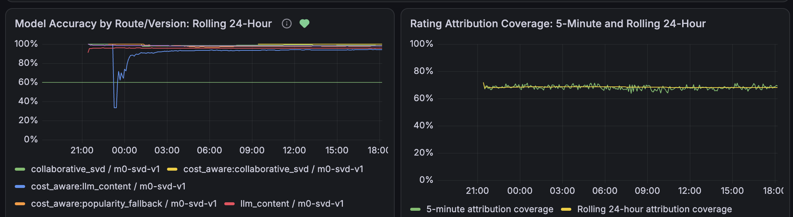
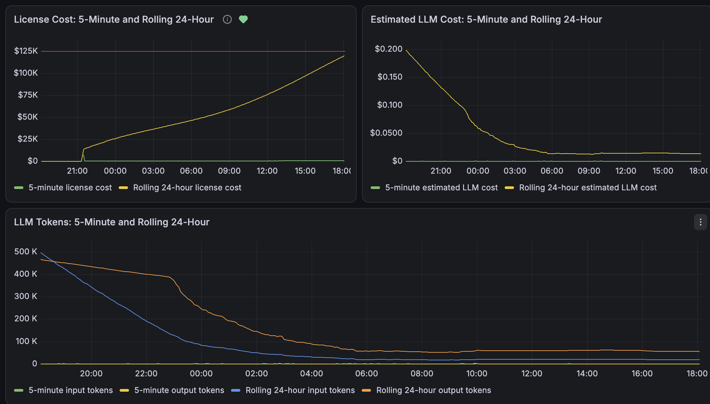
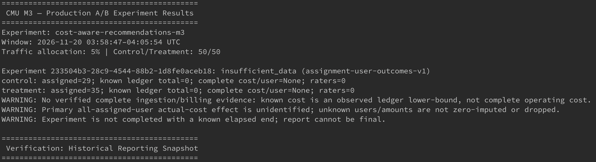

# Milestone 3 report

> Compiled draft for team review. Evidence still to finalize is marked in the relevant sections.

## Model version switching

Our Flask API uses an in-process router and model registry to serve multiple
registered model versions from one Gunicorn worker with four threads. Experiment
settings pin Control and Treatment to their chosen versions; other requests use
the current default. Pins stay fixed when the default changes. The licensing
experiment currently uses the same underlying model in both arms, with a different
ranking policy in Treatment; this differs from comparing two retrained models.

```text
Question: how do requests continue while the default model changes?

HTTP :8082 -> Flask handler -> request snapshot -> experiment router
                                                | Control pin -> model A
                                                | Treatment pin -> model B + policy
                                                | otherwise -> default model
artifacts/ -> background loader -> validate + warm -> atomically replace default
              old requests retain their original model until they finish
```

The VM's `artifacts/` directory is mounted read-only at `/inputs` in the API.
Models are external files, not baked into the image. A promotion publishes an
activation manifest identifying the version, checksum, and expected previous
model. The background loader verifies and warms the candidate while the current
model serves requests, then publishes one complete serving snapshot. Each request
keeps its snapshot through inference and logging. Failed loading retains the
current model; failed post-activation verification triggers rollback.

Milestone 1 loaded a single model at startup. The registry and router now allow
model-only updates without rebuilding the image or restarting the API. Code
deployments can still interrupt the single API process. This design keeps
deployment simple but shares memory and a failure point across versions.

Implementation: [registry and loader](https://github.com/jwatson8/The-Neural-Network/blob/8e8de53d5aa60c7d3c959c279f97862fef6043fe/src/service/model_registry.py),
[request handling](https://github.com/jwatson8/The-Neural-Network/blob/8e8de53d5aa60c7d3c959c279f97862fef6043fe/src/service/api.py),
[router](https://github.com/jwatson8/The-Neural-Network/blob/8e8de53d5aa60c7d3c959c279f97862fef6043fe/src/service/experiment_routing.py),
[promotion and rollback](https://github.com/jwatson8/The-Neural-Network/blob/8e8de53d5aa60c7d3c959c279f97862fef6043fe/deployment/daily_model.sh),
[external mount](https://github.com/jwatson8/The-Neural-Network/blob/8e8de53d5aa60c7d3c959c279f97862fef6043fe/compose.yaml).

## Regular model updates

An [hourly GitHub Actions trigger](https://github.com/jwatson8/The-Neural-Network/blob/8e8de53d5aa60c7d3c959c279f97862fef6043fe/.github/workflows/daily-model.yml)
uses persisted VM state to enforce 24 hours between attempts. Each attempt
evaluates the previous Eastern calendar day, combining the original dataset with
a bounded sample of recent interactions. A candidate is compared with the serving
model on held-out ratings. Passing the accuracy, latency, and drift gates permits
a final refit and automatic activation without restarting the API.
Implementation: [scheduler](https://github.com/jwatson8/The-Neural-Network/blob/8e8de53d5aa60c7d3c959c279f97862fef6043fe/deployment/scheduled_update.py),
[training](https://github.com/jwatson8/The-Neural-Network/blob/8e8de53d5aa60c7d3c959c279f97862fef6043fe/src/model_updates/daily.py),
[promotion policy](https://github.com/jwatson8/The-Neural-Network/blob/8e8de53d5aa60c7d3c959c279f97862fef6043fe/src/model_updates/policy.py),
[continuity probes](https://github.com/jwatson8/The-Neural-Network/blob/8e8de53d5aa60c7d3c959c279f97862fef6043fe/deployment/observe_update.py).

**Production evidence to finalize:** attach two completed promotions within the
72 hours before submission, with version changes, timestamps, continuity reports,
and course-log availability. The [November 20 attempt](https://github.com/jwatson8/The-Neural-Network/actions/runs/44693525057)
retained the original model because of insufficient data; its 29/29 successful
local probes do not demonstrate a model switch.

## Monitoring

The containerized monitoring worker computes five-minute buckets from PostgreSQL
telemetry and stores them in `monitoring_runs`. Grafana reads those results;
Healthchecks.io receives worker heartbeats to detect a stalled monitoring process.
The dashboard tracks course-log HTTP 200 availability, failed/unanswered requests,
traffic, p95 latency and the share over 600 ms; positive attributed ratings
(rating > 6) by route/model over 24 hours; licensing charges and estimated LLM
costs/tokens; and rating/event-type distribution drift using total variation
distance (TVD).

An actionable **Recommendation traffic stopped** alert fires when three complete
five-minute buckets contain zero successful requests. Grafana sends the condition,
severity, and dashboard link through the configured Discord webhook to the team's
alert channel. The responder checks API health, Kafka ingestion, and monitoring
freshness before diagnosing an outage. Additional rules cover low availability,
stale/failed monitoring, high latency, low rating quality, drift, and licensing
budget. Healthchecks.io supplies an external missing-heartbeat alert.

Implementation: [worker](src/monitoring/monitoring_worker.py),
[calculations](src/monitoring/calculations/),
[operational alerts](src/monitoring/grafana/provisioning/alerting/operational-rules.yaml),
[other alerts](src/monitoring/grafana/provisioning/alerting/),
[Compose](compose.yaml). [Dashboard access instructions](src/monitoring/grafana/README.md)
describe the SSH tunnel; mentor login details must be shared privately.

Existing production dashboard captures:







Additional views: [request latency](planning/Milestone3/evidence/request_latency_dashboard.png),
[traffic](planning/Milestone3/evidence/request_traffic_dashboard.png),
and [worker heartbeats](planning/Milestone3/evidence/health_check_service.png).

## Experimentation infrastructure

We deployed a **user-level randomized A/B experiment** in the production recommendation API to evaluate the impact of cost-aware reranking on licensing costs and user satisfaction. **5% of eligible users** are enrolled, split equally between **Control** (existing ranking) and **Treatment** (cost-aware reranking, **λ = 0.15**). Deterministic hashing and PostgreSQL ensure sticky assignments. Both groups use the pinned `m0-svd-v1` model bundle, isolating the ranking policy as the experimental difference. Treatment supports **SVD, LLM-content, and popularity-fallback** routes.

**Measurement and analysis.** Each fulfilled experimental request logs its assignment, route, model version, and request ID. The primary outcome is **actual licensing cost per assigned user** (intention-to-treat), while **movie ratings and rating participation** measure satisfaction. The reporting pipeline uses **Welch's t-test and confidence intervals** to compare group means, with **bootstrap confidence intervals** to account for skewed costs. It also checks ingestion and billing completeness before estimating treatment effects.

**Production verification.** The API returned HTTP 200 with experiment models ready. Repeated requests confirmed **sticky assignments and 4/4 assignment-linked serves**. All three treatment routes were verified, including an SVD request returning 20 recommendations through `cost_aware:collaborative_svd`. The reporting CLI also completed a successful dry run.

**Implementation:** [Experiment assignment](src/database/interactions/experiment_assignments.py) · [Recommendation serving and exposure logging](src/service/api.py) · [Statistical reporting](src/experimentation/reporting.py) · [Reporting CLI](src/experimentation/report_cli.py)

The user is the unit of randomization and analysis, avoiding treating repeated
requests from one user as independent samples. Welch's test permits unequal group
sizes and variances; independent-user bootstrap intervals provide an additional
check for skewed costs. Rating participation uses Fisher's exact test with a
Newcombe-Wilson difference interval, which supports sparse binary outcomes.
Ratings among raters can reflect selection differences, so participation is
reported alongside them. These procedures quantify uncertainty but do not repair
missing ingestion or billing records. See [statistical implementation](src/experimentation/statistics.py).

## Experiment results

The experiment began on **November 20, 2026**. An initial reporting snapshot (03:58:47–04:05:54 UTC) recorded **29 Control and 35 Treatment users**, with zero known licensing charges and zero observed raters in both groups. The reporting pipeline generated a preliminary summary; complete cost and rating effects could not yet be estimated.



*Figure: Initial production A/B experiment reporting snapshot (November 20, 2026 UTC).*

**Results to finalize:** replace or supplement this preliminary snapshot with the
completed analysis of licensing cost and ratings, including uncertainty and data
coverage. Zero observed charges or raters in this snapshot do not establish cost
savings or unchanged satisfaction.

## Provenance

Each successful recommendation receives a request UUID. PostgreSQL
`recommendation_serves` stores that UUID, serving time, actual `model_version`,
ranking route, and ordered movie IDs. HTTP headers expose `X-Request-ID`,
`X-Model-Version-ID`, and `X-Model-SHA256`; the application log records the same
identity. The API captures one serving snapshot per request, so a concurrent
switch cannot change which model is credited for the result.

The model registry binds each version label to an immutable SHA-256 checksum.
Artifact bytes live at `artifacts/models/<artifact-sha256>.joblib`; a JSON
registration named with the SHA-256 of the **version label** links those bytes to
training provenance. Reusing a version label for different bytes is rejected.
New training records `git_commit_sha` from the training image's baked
`build-revision.txt`, a Python-source checksum, and library versions. The Git
commit identifies the pipeline and learning algorithm; deploying newer serving
code does not change the training commit.

For daily models, `training_data_snapshot` identifies the frozen PostgreSQL
snapshot at `artifacts/daily/<day>/snapshot.json.gz`, the retained original CSVs
under `artifacts/training-data/<checksum>/`, and their checksums. It also records
the event cutoff, deduplication, metadata policy, and sampling caps. Training uses
the original history plus up to 100,000 selected events from the preceding seven
days and up to 100,000 from the held-out day and attribution tail; the final
refit excludes events at or after the day's end. Thus the manifest identifies a
bounded sample, not every production interaction. The database checksum covers
uncompressed JSON bytes; original-file checksums cover the compressed CSV files.

To investigate a past recommendation, find its UUID in the response or application
log, then run the [trace command](https://github.com/jwatson8/The-Neural-Network/blob/8e8de53d5aa60c7d3c959c279f97862fef6043fe/src/model_updates/trace.py)
on the team's VM:

```sh
cd /home/the-neural-network
docker compose -p the-neural-network exec -T api python -m src.model_updates.trace 63fbf04e-125e-4b4c-be73-017dbba79f6e
```

This resolves the stored version to its registration, verifies the model and
retained training-file checksums, and prints the training commit and input
manifest. Course staff with VM access can inspect the files it names and open
`https://github.com/jwatson8/The-Neural-Network/tree/<git_commit_sha>`.

**Concrete captured request:** at 00:11:21 UTC on November 20, 2026, a request for
`/recommend/1` returned HTTP 200 with:

```text
X-Request-ID: 63fbf04e-125e-4b4c-be73-017dbba79f6e
X-Model-Version-ID: m0-svd-v1
X-Model-SHA256: b677c103c9d64d6bbee56e11fc57df2fa3443d8414da89e7dc0a777ad1bb74a8
```

These captured headers establish the served model identity. Before submission,
attach a full VM trace to complete the code-and-data example. Legacy artifacts
may lack the newer training manifest or Git commit; a later deployment cannot
reconstruct missing historical provenance. Retain registrations, artifacts, and
snapshots together. This traces model training inputs; it does not archive every
historical live profile or catalog value used by surrounding serving logic.

Implementation: [prediction audit](https://github.com/jwatson8/The-Neural-Network/blob/8e8de53d5aa60c7d3c959c279f97862fef6043fe/src/service/api.py),
[version binding](https://github.com/jwatson8/The-Neural-Network/blob/8e8de53d5aa60c7d3c959c279f97862fef6043fe/src/model_updates/promotion.py),
[training identity and retained CSVs](https://github.com/jwatson8/The-Neural-Network/blob/8e8de53d5aa60c7d3c959c279f97862fef6043fe/src/model_updates/provenance.py),
[snapshot selection](https://github.com/jwatson8/The-Neural-Network/blob/8e8de53d5aa60c7d3c959c279f97862fef6043fe/src/model_updates/snapshot.py),
[training manifest](https://github.com/jwatson8/The-Neural-Network/blob/8e8de53d5aa60c7d3c959c279f97862fef6043fe/src/model_updates/daily.py).

## Incident response plan and drill

The [incident response plan and drill protocol](planning/Milestone3/alvajoy_incident_response_plan_and_drill.md)
assigns Alvajoy incident coordination and stakeholder updates; Nathan monitoring
and alert checks; Jace deployment and model rollback; and Frank data quality and
experiment assessment. It calls for incident updates every 15 minutes and
post-recovery checks of response status, latency, and output validity. Detection
uses the Grafana/Healthchecks.io alerts described above, with Discord delivery.

**Plan details to finalize:** the linked draft still mentions Prometheus and Teams;
align those references with the deployed PostgreSQL/Grafana/Discord setup and give
the mentor concrete instructions for urgently contacting the team. Its existing
mentor-escalation instructions describe contacting course staff rather than how
management reaches the team.

**Drill evidence to add:** document the fault actually injected, its timestamp,
the monitoring detection, the delivered notification and recipient, the recovery
action, and restored health/traffic. Include logs or screenshots linking these
steps. The current document is a plan and drill protocol; it does not yet record
a completed drill. A naturally occurring alert alone is not evidence of the
required deliberate fault injection and recovery.

## Team contract update

No update to team contract. Our existing team contract remains in effect; see the [Milestone 2 report](m2_report.md).
