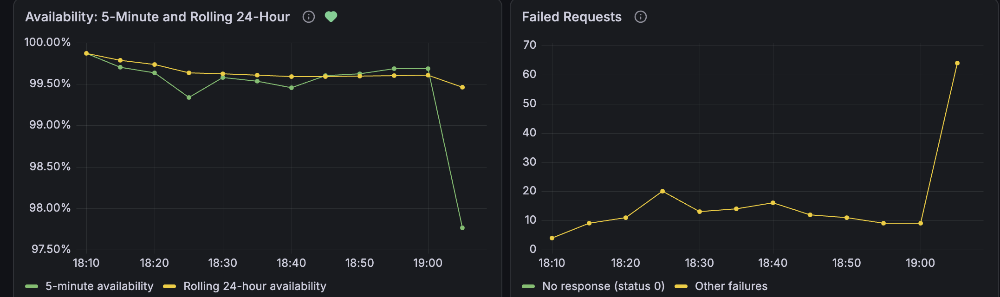
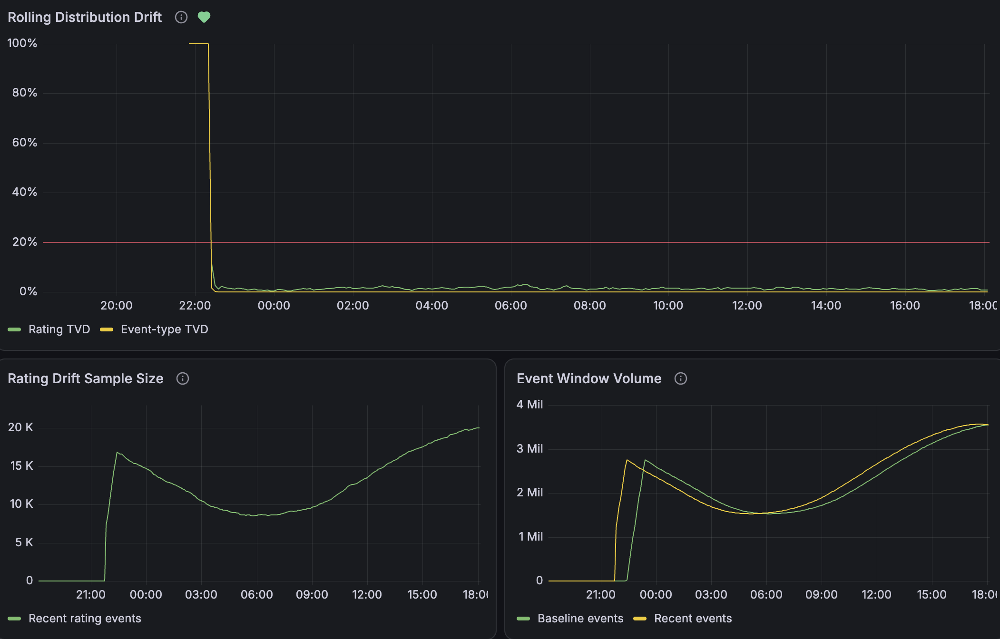
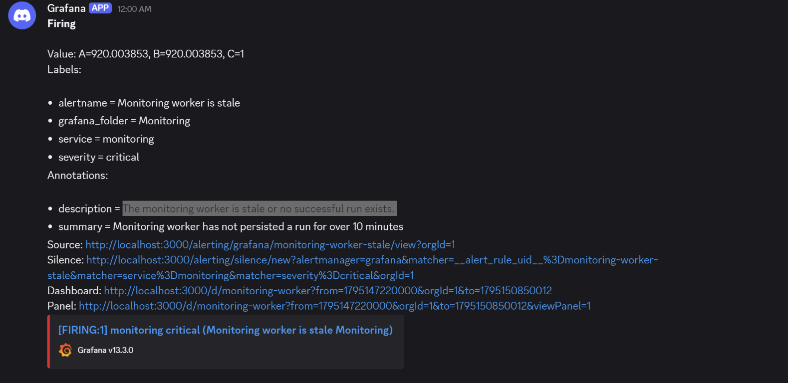
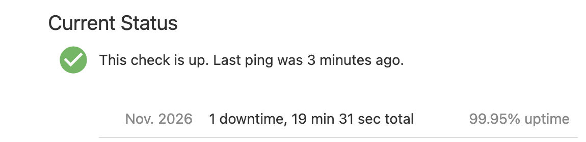

# Milestone 3 report

> Draft for team review. Production evidence still needed is identified below.

## Model version switching

Our Flask API uses an in-process model registry and router to serve registered
versions in one Gunicorn worker with four threads. Experiment arms can pin
different versions while other requests use the current default. The licensing
experiment instead pins both arms to `m0-svd-v1` and changes the ranking policy.

```text
HTTP request -> request snapshot -> Control pin / Treatment pin / default
artifacts -> background loader -> validate and warm -> atomic default swap
                                                   -> existing requests finish on old snapshot
```

The VM's model artifacts are mounted read-only into the API. A promotion
publishes an activation instruction with the candidate version, checksum and
expected previous model. The loader validates and warms the candidate before
publishing a new snapshot; failed loading retains the old model and failed
post-activation verification triggers rollback. Pins do not change with the
default. Unlike Milestone 1's single model loaded at startup, model-only
updates do not require an API restart or image rebuild. Code deployments can
still interrupt service, and the single API process is a shared failure point.

Implementation: [registry](src/service/model_registry.py),
[router](src/service/experiment_routing.py),
[promotion and rollback](deployment/daily_model.sh), and [Compose](compose.yaml).

## Regular model updates

An [hourly workflow](.github/workflows/daily-model.yml) schedules candidates
subject to quality, latency and drift gates. The
[November 20 attempt](https://github.com/jwatson8/The-Neural-Network/actions/runs/44693525057)
retained the original model; its 29/29 successful local probes do not demonstrate
a switch. The later
[November 21 scheduler check](https://github.com/jwatson8/The-Neural-Network/actions/runs/44863731640/job/136722651332)
reported `not_due` and identified the last attempt as `not_promoted`.

**Evidence still required:** two promotions in the 72 hours before submission,
with version changes, timestamps, `promotion.json`, corresponding
`continuity-*.json` and course-log availability. Local
[continuity probes](deployment/observe_update.py) alone are not course-wide
availability.

## Monitoring

The [monitoring worker](src/monitoring/monitoring_worker.py) aggregates
PostgreSQL telemetry into five-minute `monitoring_runs` buckets; Grafana reads
these and Healthchecks.io receives worker heartbeats. We monitor course-log
HTTP 200 availability, failed requests, traffic and latency; the rolling
24-hour share of attributed ratings **at least 6** by route and model; licensing
charges and estimated LLM token costs; and rating and event-type distribution
drift using total variation distance. Rating attribution uses a user/movie/time
heuristic and does not establish a causal effect.

The actionable [monitoring-worker-stale alert](src/monitoring/grafana/provisioning/alerting/operational-rules.yaml)
fires when the latest saved run is over 600 seconds old for five minutes.
Grafana's [notification policy](src/monitoring/grafana/provisioning/alerting/notifications.yaml)
routes alerts to the team's Discord channel via webhook; a responder checks
monitoring freshness and API health. The drill below documents its delivery.
Other rules cover stopped traffic, low availability, failed monitoring, high
latency, low quality, drift and licensing budget. Healthchecks.io provides a
missing-heartbeat alert.

[Dashboard access instructions](src/monitoring/grafana/README.md) describe the
SSH tunnel; provide mentor access privately. The following captures show the
required metrics, not seven-day availability. For the required window, collect
course-side evidence for the 72 hours before and 96 hours after submission;
request success percentages alone do not establish total downtime in hours.






## Experimentation infrastructure

The production user-level A/B experiment enrolls 5% of eligible users, with
an expected 50/50 split. Separate deterministic hashes select enrollment and
variant; a unique PostgreSQL assignment keeps each enrolled user in the same
group. Control uses the existing ranking; Treatment reranks candidates with
`adjusted_score = percentile_relevance - 0.15 * normalized_cost`, using catalog
license prices. Both arms use the pinned `m0-svd-v1` bundle, isolating the
ranking policy rather than comparing separately trained models. Treatment
supports SVD, LLM-content and popularity-fallback routes.

Fulfilled serves log assignment, request ID, route and actual model version.
The primary outcome is actual ledger licensing cost per **assigned user**,
including users without activity when completeness is verified. Post-assignment
ratings, watches and charges are analyzed by assigned user, not linked to a
specific recommendation; they can include organic activity. Average rating
among raters is secondary, alongside rating participation, because who rates
may differ between arms. Missing ingestion or billing coverage prevents a valid
all-user cost estimate rather than implying zero cost.

The report compares user-level means using a two-sided Welch t-test and 95%
confidence interval, allowing unequal variances and group sizes; an independent
user bootstrap interval checks robustness to skew. Fisher's exact test and a
Newcombe-Wilson interval compare binary participation. User-level analysis
avoids treating repeated requests as independent. Small samples and skew can
still make intervals unreliable, and nonsignificance does not establish equal
quality. Reports are provisional until coverage and other completeness checks
pass; repeated looks are not automatically valid sequential tests.

Production checks recorded sticky assignments and 4/4 assignment-linked serves
across repeated test requests, plus treatment execution across all three routes.
These checks establish instrumentation, not effectiveness.
Implementation: [assignment](src/experimentation/assignment.py),
[serving](src/service/api.py), [reranking](src/experimentation/cost_aware_reranking.md),
[reporting](src/experimentation/reporting.md), and
[statistics](src/experimentation/statistics.py).

## Experiment results

The question is whether cost-aware ranking lowers actual licensing cost without
unacceptable changes in user ratings. In the initial November 20, 2026 snapshot
(03:58:47–04:05:54 UTC), 29 Control and 35 Treatment users were assigned.
Both groups had zero **known recorded** charges and zero observed raters.
Ingestion and billing completeness was unverified, so actual cost per user,
rating differences and their uncertainty could not be estimated. The experiment
was not complete; these observations do not establish savings or unchanged
satisfaction.


Separately, a [historical offline diagnostic](src/experimentation/cost_aware_reranking.md#historical-sample-interpretation)
at the same weight found a 3.93% lower **catalog reference cost per slate** for
100 sampled SVD users, with a mean percentile-relevance loss of 0.000823.
This is an in-sample ranking proxy, not an observed licensing saving or user
rating result, and cannot answer the online experiment question.

**Evidence still required:** a completed outcome report showing cost and rating
results with uncertainty and verified data coverage. The
[reporting instructions](src/experimentation/reporting.md#cli-and-worker) show
how to generate a report for an authorized database and observation window.

## Provenance

Each successful recommendation has a request UUID and a PostgreSQL
`recommendation_serves` record containing its actual model version, time,
route and returned movie IDs. Response headers expose the request ID, model
version and artifact SHA-256. A request retains its model snapshot through
inference and audit.

The registry binds a version label to an immutable model digest and training
metadata. New training records the image's Git commit, source checksum,
library versions, cutoff and training-data manifest. Daily models retain
original CSVs under `artifacts/training-data/<checksum>/` and the selected
PostgreSQL snapshot under `artifacts/daily/<day>/snapshot.json.gz`. The manifest
records sampling caps, so the snapshot is not the complete production history.
Model bytes, registrations and snapshots must be retained together on the
access-controlled VM.

The team's [captured example](https://github.com/jwatson8/The-Neural-Network/blob/main/planning/Milestone3/provenance.md)
records a successful request at 00:11:21 UTC on November 20, 2026:

```text
X-Request-ID: 63fbf04e-125e-4b4c-be73-017dbba79f6e
X-Model-Version-ID: m0-svd-v1
X-Model-SHA256: b677c103c9d64d6bbee56e11fc57df2fa3443d8414da89e7dc0a777ad1bb74a8
```

With authorized VM access, resolve that request through its registration and
verify the model and retained input checksums:

```sh
cd /home/the-neural-network
docker compose -p the-neural-network exec -T api python -m src.model_updates.trace 63fbf04e-125e-4b4c-be73-017dbba79f6e
```

The [trace implementation](src/model_updates/trace.py) prints the stored training
commit and manifest when available; the commit identifies the pipeline code, and
the manifest identifies retained data. **A full trace of this example is still
needed.** Older models can lack a recorded training commit or manifest, which
cannot be reconstructed merely by deploying newer code. Historical live
profiles and catalog values used during serving are not all archived.
See [training provenance](src/model_updates/provenance.py),
[snapshot selection](src/model_updates/snapshot.py) and
[prediction logging](src/service/api.py).

## Incident response plan and drill

The [incident response plan and drill protocol](planning/Milestone3/alvajoy_incident_response_plan_and_drill.md)
assigns Alvajoy incident coordination, Nathan monitoring, Jace deployment and
rollback, and Frank data and experiment assessment. It calls for 15-minute
status updates and post-recovery checks. Management can urgently reach the team
via a Teams message and call, followed by the privately pinned phone contact if
needed. The plan describes the deployed Grafana-to-Discord alert path and an
approval-gated monitoring-worker-stale drill with an explicit restore procedure.

**Drill:** On November 20, the team exercised its response to a deliberately
injected failure. The **Monitoring worker is stale** alert reached the whole
team through Discord. The team joined a Discord call, investigated and rolled
a fix forward to the deployment to resolve the issue. The team identified
[#67](https://github.com/jwatson8/The-Neural-Network/pull/67) as the relevant
fix: it changed data-drift processing to use database-side event counts. The PR
was merged at 05:26 UTC; the merge alone does not establish deployment time.
The screenshot shows the Grafana alert firing in Discord, with the latest run
approximately 920 seconds old. Team receipt and response are reported by a
team member.



The team identified the following heartbeat capture as recovery evidence. It
shows the check up, but does not itself establish its time relative to the drill.



**Evidence still required:** record the injection method, alert and deployment
times, and verification of restored health/traffic; link deployment and
recovery logs or screenshots.

## Team contract update

No update to team contract. The existing [team contract](planning/Milestone1/m0%20-%20meeting%20notes%20and%20team%20contract.md)
remains in effect.
