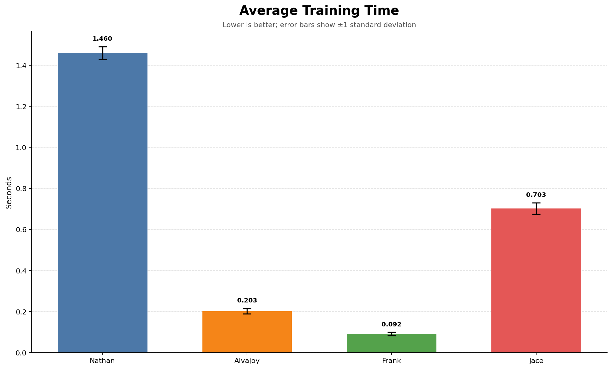

# Model Evaluations
Our models were evaluated according to 4-qualities:
1) Training time,
2) Throughput 
3) Model size
4) Reccomendation Quality

## Training Time

### Metric
Average time of training on the same dataset.
### Data
Used the provided `events.csv.gz` dataset.
### Operationalization
Split the `events.csv.gz` dataset according to an `80/20` split (80% of data for training, 20% for testing - training data for this test and subsequent tests need to split training/testing per user. The most recent 20% of a user's watch events go into testing, the remaining 80% in training. Make sure to only include rating events, remove watch+account_creation events). In the code for loading the model and training it, save a variable and start a performance check before training. Check performance after training and record the difference. Set a variable and start a performance check before loading the model, do the same after loading the model and record the difference. Run the test 20 times and record the average for each model.

## Throughput

### Metric
Average time to generate K-20 reccomendations for a given user.
### Data
Use the trained models and the holdout test data described above in *Training Times*.
### Operationalization
The model's prediction capacity is restricted to "warm" items (e.g., movies that exist in the training data). Go through the testing data and exclude any movie that doesn't appear at least once in the training data (this is also important because Jace's model uses the full movie catalog metadata for scoring, so this "evens" the playing field). Run performance tests before and after the model makes a prediction and record the difference. Run the test 100 times and take the average.
## Model Size
### Metric
Size of the saved, exported model.
### Data
Use the train models as described above in *Training Times*.
### Operationalization
Inspect the size of each model and graph them.
## Reccomendation Quality
### Metric

### Data
### Operationalization

