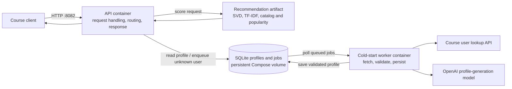

# Inference Service Deployment

The service is packaged as one Python image and run by Docker Compose as two
processes on a Linux VM: a Gunicorn HTTP API on port 8082 and a cold-start profile
worker. The recommendation bundle is supplied as a read-only host-file mount, not
baked into the image. Compose gives the API and worker a shared named volume for
SQLite profiles and queued jobs. The API loads the bundle at startup; `/health`
stays unavailable until the model and profile store are ready.

**Architecture question:** How does a new user's slow profile generation stay out
of the recommendation request path, while later requests can use that profile?

The model artifact and inference scoring are separate from request/business logic:
the API selects a recommendation route, returns at most 20 IDs as plain text, and
queues unknown users; the worker performs user lookup and LLM work asynchronously.
Until a profile is saved, an unknown user receives popularity fallback results.
Subsequent requests can use the stored profile for content ranking. The LLM used
to create profiles is an external dependency, distinct from the mounted
recommendation model.

**Accepted trade-off:** SQLite on a single VM keeps deployment and durable
cross-process state simple, with no separate database service to operate. It ties
the API and worker to that VM and its volume, and SQLite write contention and VM
failure limit scaling and availability. New users also see fallback results until
the worker finishes.

This describes the intended Compose deployment; no VM deployment or live
course-traffic test has been performed. Set the values in `.env.example` in a
private `.env`, provide the trusted model file at `MODEL_FILE`, then run
`docker compose up -d --build`. The worker requires the user lookup endpoint and
`OPENAI_API_KEY`. The account-created Kafka contract is not implemented; unknown
recommendation requests are the current queue trigger.

**Implementation pointers**

- [Dockerfile](https://github.com/jwatson8/The-Neural-Network/blob/flasksrc/Dockerfile)
- [Compose file](https://github.com/jwatson8/The-Neural-Network/blob/flasksrc/compose.yaml)
- [HTTP request handling](https://github.com/jwatson8/The-Neural-Network/blob/flasksrc/src/service/api.py)
- [Model inference and route selection](https://github.com/jwatson8/The-Neural-Network/blob/flasksrc/src/service/model_adapter.py)
- [Cold-start worker](https://github.com/jwatson8/The-Neural-Network/blob/flasksrc/src/service/profile_worker.py)
- [Persistent profiles and job queue](https://github.com/jwatson8/The-Neural-Network/blob/flasksrc/src/service/store.py)
- [VM and Compose operations runbook](https://github.com/jwatson8/The-Neural-Network/blob/flasksrc/planning/VM_DOCKER_COMPOSE_RUNBOOK.md)