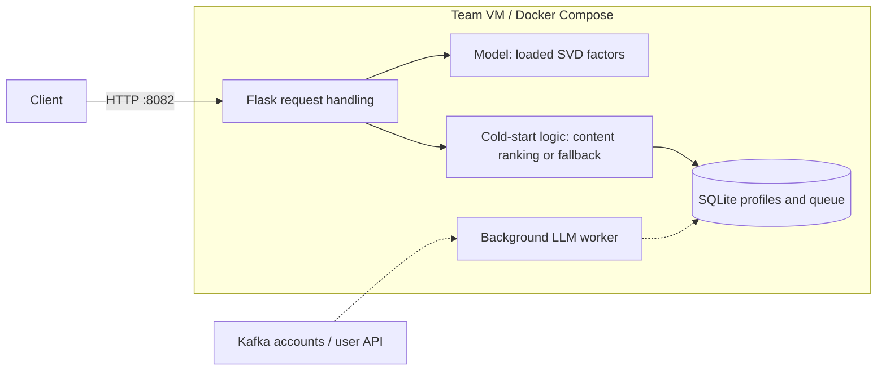

# Containerization and deployment

Our inference service runs on the team's Ubuntu 24.04 VM in a Python 3.12 Docker container. Gunicorn serves Flask on port 8082. Request-handling logic loads the trained SVD model once, ranks unseen movies for known users, and returns up to 20 comma-separated movie IDs. Users with cached LLM profiles receive content-based rankings; unknown users receive a popularity fallback and enter a profiling queue. Model files are mounted read-only; profiles and queued jobs persist in a Docker volume backed by SQLite.

**Architecture question: how does a recommendation request reach the model, and where does cold-start processing occur?** Solid arrows show the deployed service; dashed arrows show prepared, inactive live profiling.

Deployment uses SSH and repository configuration. Check out `deployment/docker-smoke-test`, provide `artifacts/model.joblib` and `artifacts/llm_profiles.json`, then run `sudo env BIND_ADDRESS=0.0.0.0 docker compose -f compose.smoke.yaml up -d --build --wait`. The [Dockerfile](https://github.com/jwatson8/The-Neural-Network/blob/419e04360686621844fb02a0a93f847abd60f52b/Dockerfile), [Compose configuration](https://github.com/jwatson8/The-Neural-Network/blob/419e04360686621844fb02a0a93f847abd60f52b/compose.smoke.yaml), and [deployment/test instructions](https://github.com/jwatson8/The-Neural-Network/blob/419e04360686621844fb02a0a93f847abd60f52b/deployment/README.md) document reproduction. Six VM smoke checks passed; an external request returned HTTP 200 in 202 ms. These checks do not establish sustained throughput or grading-traffic totals.

**Trade-off:** a single VM and Compose keep deployment simple and reproducible, but provide no host redundancy and accept a brief interruption during container replacement.

**Current limitation:** the [live-worker configuration and activation instructions](https://github.com/jwatson8/The-Neural-Network/blob/419e04360686621844fb02a0a93f847abd60f52b/deployment/LIVE_SETUP.md) are prepared, but automatic new-user profiling and Kafka verification await course connection details and an authorized LLM key. This part of Milestone 1 is not yet verified. Update this paragraph and diagram after activation.
