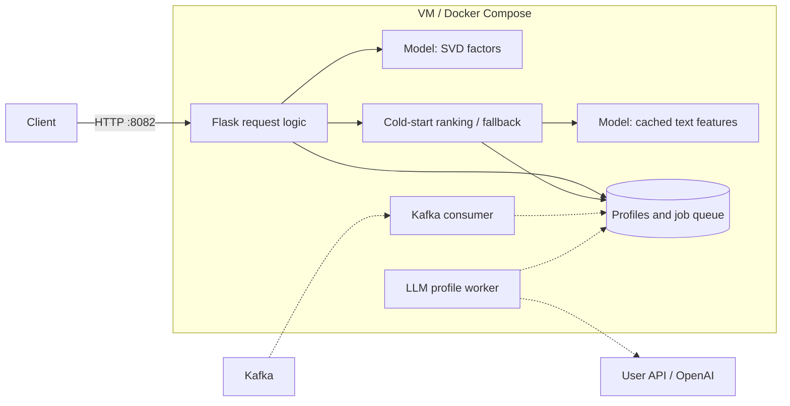

# Containerization and deployment

Our Python 3.12 inference service runs in Docker on the team's Ubuntu VM, deployed over SSH from `/home/the-neural-network`. Gunicorn serves Flask on port 8082. Request logic selects SVD ranking for known users, content ranking for saved LLM profiles, or popularity while a profile is pending. The model loads once from a read-only mount; SQLite profiles and jobs persist in a named Docker volume.

**Architecture question: which components answer requests, and which prepare cold-start profiles?** Solid arrows are verified serving paths; dashed arrows are implemented live paths awaiting verification.

The [Dockerfile](../../Dockerfile) packages the service and recorded data. [Compose](../../compose.yaml) provides a training command and starts the API with `docker compose up -d --wait`; optional live services use `--profile live`. The [deployment guide](../../deployment/README.md) documents configuration, training, staging on port 18082, switching to 8082, and rollback.

On the VM, training and six HTTP smoke checks passed. The integrated service returned HTTP 200 externally in 273 ms. OpenAI authentication also succeeded; this does not verify profile generation or course traffic.

**Trade-off:** one VM and Compose simplify operation but provide no host redundancy; replacing containers accepts a brief interruption.

**Remaining verification:** enable the live services with course connection settings, demonstrate a new user's LLM profile and personalized response, and verify the required Kafka request counts. These steps are not yet confirmed.
