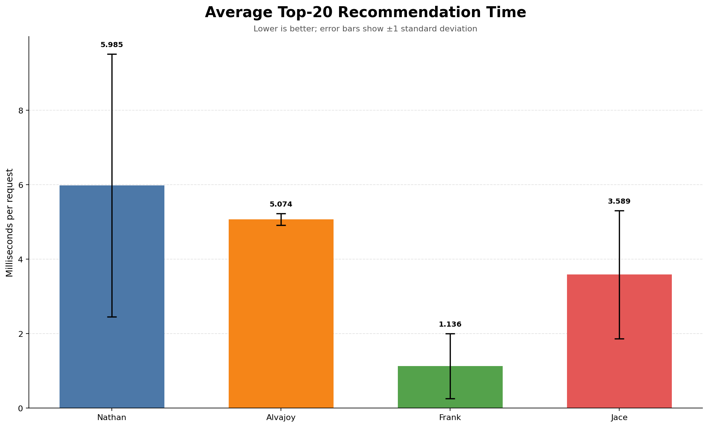
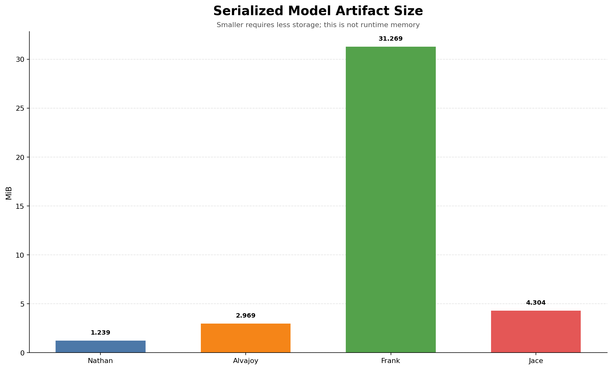
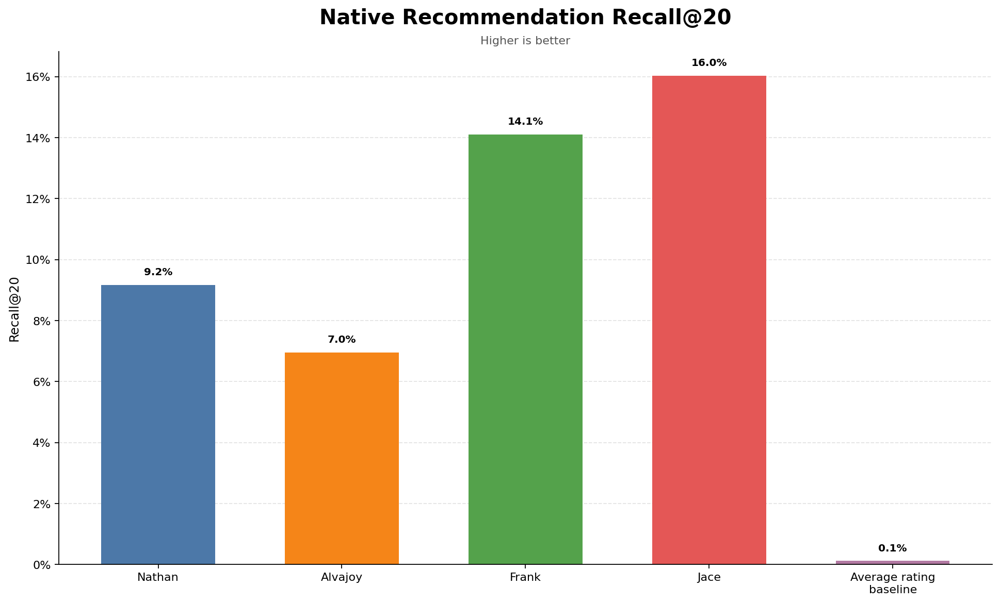
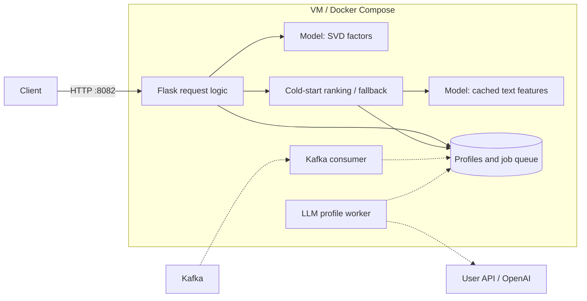

# 1: Model Comparison
Our models were evaluated according to numerous qualities. For the purpose of this report, we will focus on 4-qualities:
1) Training time,
2) Throughput 
3) Model size
4) Reccomendation Quality

To see more data and graphical representations of evaluations, see `./modelTesting/results/graphs`. To see the code used for evaluation, see `./modelTesting/train_all.py`, `./modelTesting/inference_tests.py`, `./modelTesting/throughput.py`. 

Origional milestone models can be found here:  
[Jace's Milestone Zero](https://github.com/jwatson8/S3D17645_Movie_Recommendation)  
[Frank's Milestone Zero](https://github.com/franktsai127/ml-m0-recommender)  
[Alvajoy's Milestone Zero](https://github.com/AlvajoyAsante/SWE-AI-CMU/tree/main/ML%20in%20Production/Milestone%200)  
[Nathan's Milestone Zero](https://github.com/cheepsahoy/cmu-milestoneZero)  

Models had to be slightly modified to fit the demands of this testing regiment. Specifications can be found in `./modelTesting/NOTES.md`, changes to model-training found in folders bearing the name of each group member.

## Training Time

### Metric
Average time of training and loading on the same dataset.
### Data
Used the provided `events.csv.gz` dataset.
### Operationalization
Split the `events.csv.gz` dataset according to an `80/20` split (80% of data for training, 20% for testing - training data for this test and subsequent tests need to split training/testing per user. The most recent 20% of a user's watch events go into testing, the remaining 80% in training. Make sure to only include rating events, remove watch+account_creation events). In the code for loading the model and training it, save a variable and start a performance check before training. Check performance after training and record the difference. Set a variable and start a performance check before loading the model, do the same after loading the model and record the difference. Run the test 20 times and record the average for each model.
### Results
    Jace: 703ms
    Frank: 92ms
    Alvajoy: 203ms
    Nathan: 1460ms

## Inference Latency

### Metric
Average time, per request, to generate K-20 reccomendations for a given user.
### Data
Use the trained models and the holdout test data described above in *Training Times*.
### Operationalization
The model's prediction capacity is restricted to "warm" items (e.g., movies that exist in the training data). Go through the testing data and exclude any movie that doesn't appear at least once in the training data (this is also important because Jace's model uses the full movie catalog metadata for scoring, so this "evens" the playing field). Run performance tests before and after the model makes a prediction and record the difference. Run the test 100 times and take the average. Report ms per requrest.
### Results
    Jace: 3.589ms
    Frank: 1.136ms
    Alvajoy: 5.074ms
    Nathan: 5.985ms
## Model Size

### Metric
Size of the saved, exported model.
### Data
Use the train models as described above in *Training Times*.
### Operationalization
Inspect the size of each model and graph them. Report as MB.
### Results
    Jace: 4.304 mb
    Frank: 31.269 mb
    Alvajoy: 2.969 mb
    Nathan: 1.239 mb
## Reccomendation Quality

### Metric
Recall (@20)
### Data
Use the models as described above in *Training Times*, and operationalize the testdata as described in *Throughput*
### Operationalization
To calculate the value, for each model obtain a k-20 listing for the user. Ensure that the no movies already-seen by the user are included in the k-20 reccomendation. Go through the test data and find every movie in the test data for that user that scored above a baseline (x > 7.5). That comprises total-known relevent movies. Now, find the intersection between total known relevent moves and the k-20 model reccomendation for that user. the ratio of the two is recall @ 20. This is essentially recall (TP / TP + FN). Now calculate the average of these reccomendations accross every user in the dataset and calculate the mean. Do this for every model. Calculate against a baseline model (reccomend the top rated moves in the movie-dataset)
### Results
    Baseline: .1%
    Jace: 16%
    Frank: 14.1%
    Alvajoy: 7%
    Nathan: 9.2%
## Final Selection and Rationale
### Jace's Model
Ultimately, we concluded that Jace's model was the best. It stuck a balance between size, throughput, and training-time while having the most desireable reccomendation quality according to recall@20. In other metrics not discussed here, Jace's model scored similarly top-tier.

# 2: Prediction Service
The Flask API loads the selected Jace model bundle at startup (by default, `src/app/fullTrainedModel/jace_model.joblib`; deployments can override this with `MODEL_PATH`). `GET /recommend/<user_id>` returns up to 20 movie IDs as one comma-separated `text/plain` response. If the model is unavailable, the API returns HTTP 503.

The model is loaded once when the service starts so requests can use it without re-reading the artifact. The `/health` endpoint reports whether the model and profile store are ready. The recommendation route records the selected route, model version, response time, and status in its log output.

For a user with interaction history, the serving adapter scores every movie by the dot product of that user's learned SVD factors and the movie factors. It removes movies already seen by the user, orders the remaining scores from high to low, and returns the first 20 distinct IDs. This is a ranking score, not a predicted star rating. The factors are learned by 32-component TruncatedSVD over the user/movie interaction matrix; explicit ratings overwrite watch-only values.

The SVD model represents users and movies as vectors in a shared latent space. A larger dot product indicates a stronger match according to the patterns in the training interactions. The service sorts these scores to produce an ordered list; it does not convert them into calibrated ratings or a probability that a user will like a movie.

Filtering seen movies prevents the endpoint from returning items the user has already watched or rated. The final list is capped at 20 IDs, which keeps the response compact for the consuming application.

For a new user without interaction history, the cold-start process (`src/service/cold_start.py`) asks an LLM to create a personalized SVD "fingerprint" from the user's profile and stated preferences, such as genres and types of movies they enjoy or avoid. The fingerprint is intended to represent those preferences in the same latent space as the model's movie factors. The service can then score candidate movies by comparing the new user's fingerprint with each movie factor, while filtering out any movies they have already seen. This makes it possible to personalize recommendations before the user has built up an interaction history. The fingerprint is generated asynchronously. One change we made to the origional Jace model was the 'default' fallback. Since communication with the LLM exceeds the 600ms timeframe needed for user experience, the user receives highly-ranked and popular movies in the interim while the LLM helps populate their fingerprint.

The selected model's learned SVD parameters were not changed for this service. The planned extension retains the trained movie factors and uses each new user's profile and preferences to create a compatible user-specific fingerprint. The existing dot-product ranking can then be reused for that user. The fingerprint generation and storage steps are service additions; they do not require retraining the shared model for every new account.

# 3: Containerization and deployment

Our Python 3.12 inference service runs in Docker on the team's Ubuntu VM, deployed over SSH from `/home/the-neural-network`. Gunicorn serves Flask on port 8082. Request logic selects SVD ranking for known users, content ranking for saved LLM profiles, or popularity while a profile is pending. The model loads once from a read-only mount; SQLite profiles and jobs persist in a named Docker volume.

**Architecture question: which components answer requests, and which prepare cold-start profiles?** Solid arrows are verified serving paths; dashed arrows are implemented live paths awaiting verification.

The [Dockerfile](../../Dockerfile) packages the service and recorded data. [Compose](../../compose.yaml) provides a training command and starts the API with `docker compose up -d --wait`; optional live services use `--profile live`. The [deployment guide](../../deployment/README.md) documents configuration, training, staging on port 18082, switching to 8082, and rollback.

On the VM, training and six HTTP smoke checks passed. The integrated service returned HTTP 200 externally in 273 ms. OpenAI authentication also succeeded; this does not verify profile generation or course traffic.

**Trade-off:** one VM and Compose simplify operation but provide no host redundancy; replacing containers accepts a brief interruption.

**Remaining verification:** enable the live services with course connection settings, demonstrate a new user's LLM profile and personalized response, and verify the required Kafka request counts. These steps are not yet confirmed.

# 4: Meeting Notes and Team Contract

## Meeting Note
- [Meeting Notes](https://docs.google.com/document/d/1KkiqGav8hNbT_1qaAIR9rnov3ghDki5VzYoF1GzO2R4/edit?tab=t.68e54dbq2yxa)

## Communication Norms and Expectations

- Team members are expected to check and respond to messages within the same day.
- We use Microsoft Teams as our primary communication tool.
- For urgent or emergency communication:
  1. Initiate a call through Microsoft Teams chat.
  2. If needed, call the phone number in the pinned Teams message.

## Roles and Responsibilities

- **Nathan:** Project management and keeping members on track.
- **Jace:** GitHub issue tracker and GitHub Project Board.
- **Frank:** Deadline tracking.
- **Alvajoy:** Meeting notes and keeping meetings on track.

Regular team meetings are scheduled for **Thursdays, 7:30–8:30 PM Eastern Time (ET)** and announced through the Teams scheduler app. Meetings outside the recurring time are arranged by a group vote on Teams.

The team will check in during **Milestone 2** to decide whether to reassign roles.

## Dividing Work and Assigning Responsibilities

- The team decides work division collectively.
- Members volunteer for tasks first. Ties are resolved through group discussion.
- Remaining tasks are assigned by lot.

## Team and Interpersonal Conflict Resolution

The team agreed on this escalation process:

1. Meet and discuss the issue as a group.
2. If an agreement cannot be reached, involve our TA, **Shantanu**.
3. If the matter remains unresolved, bring it to the professor.

## Handling Unresponsive Members, Problems, and Delays

Team members are expected to check and respond to messages **within the day** through Teams. For urgent matters, members will first attempt a Teams call, followed by a phone call using the contact information pinned in Teams. If the team member cannot be reached by phone, we will notify our TA, **Shantanu**. If a team member encounters difficulties or delays with their assigned tasks, other team members can step in to provide assistance and help resolve the issues.