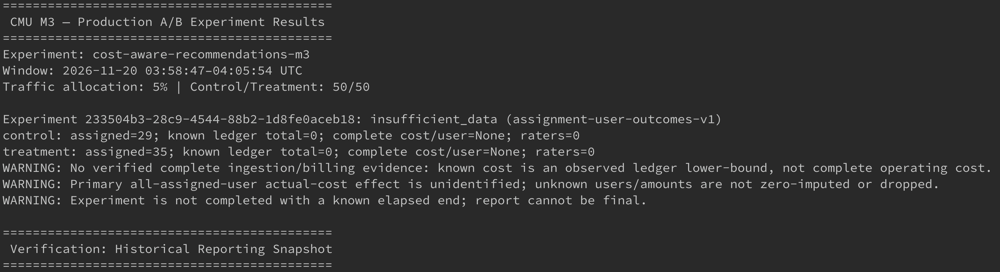

## Experimentation Infrastructure

We deployed a **user-level randomized A/B experiment** in the production recommendation API to evaluate whether cost-aware reranking reduces movie licensing costs while maintaining user satisfaction. **5% of eligible users** are enrolled and assigned equally to **Control** (existing ranking) or **Treatment** (cost-aware reranking, **λ = 0.15**). Deterministic hashing and a unique PostgreSQL assignment ensure that users remain in the same group across requests. Both groups use the pinned `m0-svd-v1` model bundle, isolating the ranking policy as the experimental difference. Treatment reranking penalizes higher catalog licensing costs while preserving relevance and supports **SVD, LLM-content, and popularity-fallback** recommendation routes.

**Measurement and statistical analysis.** Each fulfilled experimental recommendation records its assignment ID, route, model version, and request ID. Subsequent watch/rating events and actual licensing charges are analyzed by assigned user, without assuming a direct link from an individual recommendation to a later watch. The **primary outcome** is actual licensing cost per assigned user, including users with no observed activity (**intention-to-treat**). Group means are compared using **Welch's t-test and confidence intervals** to accommodate unequal spending variances; **bootstrap confidence intervals** provide a robustness check for skewed costs. **Ratings among users who rate** are a secondary satisfaction measure, reported alongside rating participation because participation may differ by group. The reporting CLI checks ingestion and billing completeness and withholds cost-effect conclusions when outcome coverage is unverified.

**Production verification (November 19 PT / November 20 UTC).** The API returned HTTP 200 with experiment models ready. Two test users each made two successful requests, retaining **one assignment per user** and producing **4/4 assignment-linked serves**. Treatment routing and exposure records were verified across all three recommendation routes; a targeted SVD request returned 20 recommendations using `cost_aware:collaborative_svd`. The statistical reporting CLI also completed a dry run successfully. These checks verify experiment execution and instrumentation, not treatment effectiveness.

**Implementation:** [user assignment](src/database/interactions/experiment_assignments.py) · [serving and exposure logging](src/service/api.py) · [reporting CLI](src/experimentation/report_cli.py) · [statistical analysis](src/experimentation/reporting.md).

## Experiment Results

The production A/B experiment was activated on November 20, 2026, with **5% traffic enrollment** and a **50/50 Control–Treatment split**. Production end-to-end tests confirmed stable user assignments, successful recommendation serving, and exposure logging across SVD, LLM-content, and popularity-fallback routes.

The initial reporting snapshot (03:58:47–04:05:54 UTC) recorded **29 Control users and 35 Treatment users**. Both groups had zero recorded licensing charges and zero observed raters during this observation window. The reporting pipeline successfully processed the experiment data and produced a preliminary outcome summary. Complete cost and rating effects could not yet be estimated from this snapshot.

*Figure: Initial production A/B experiment reporting snapshot (November 20, 2026 UTC).*