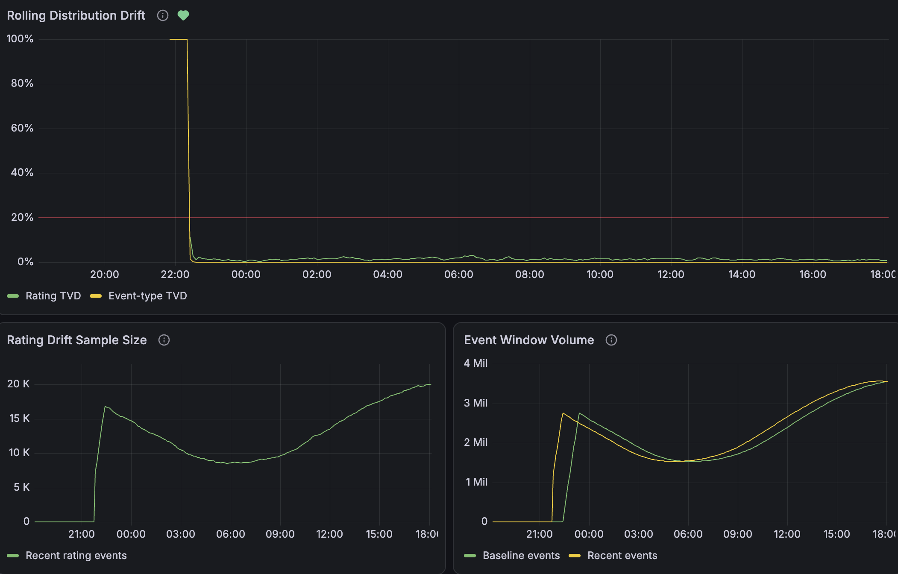
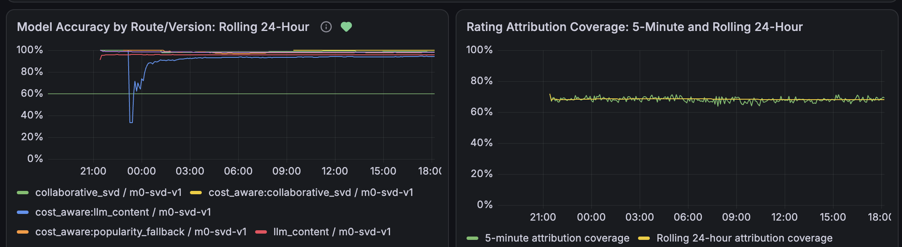
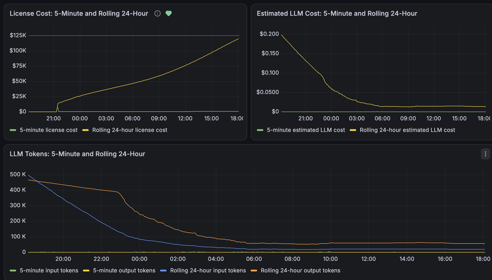
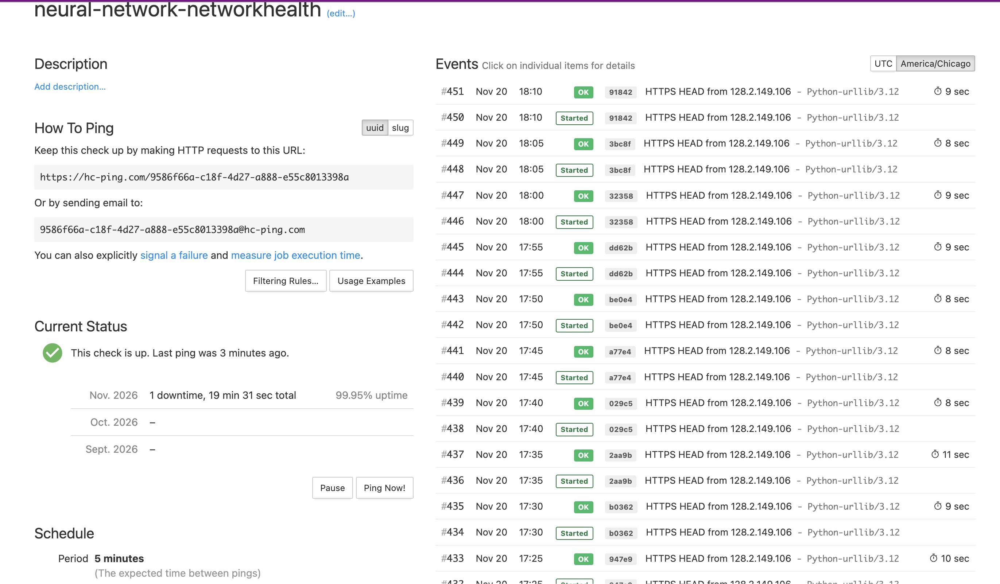
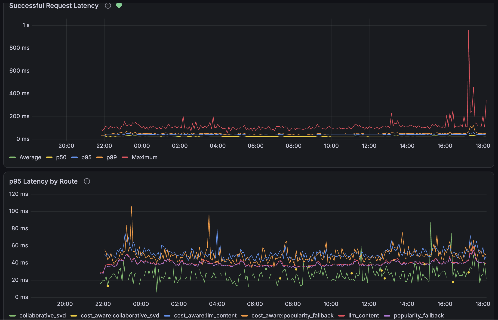
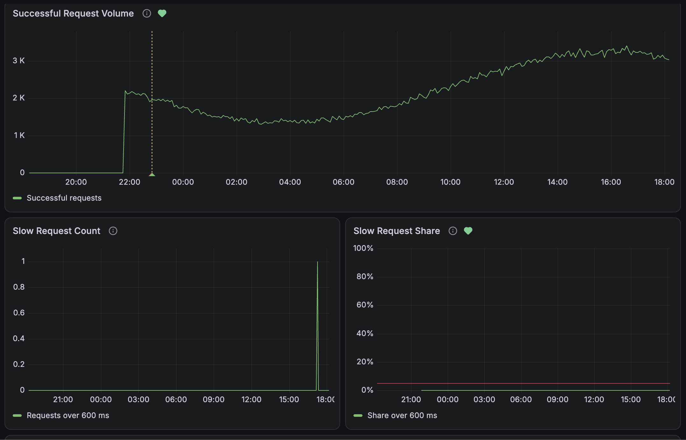
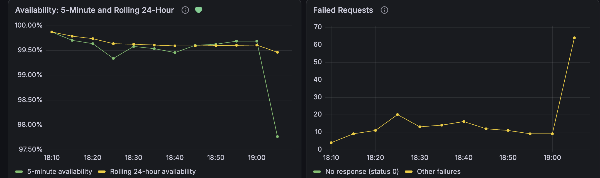

# Monitoring
## Infrastructure
As of Milestone 3 our project's monitoring infrastructure is robust. Our monitoring infrastructure can be found under [monitoring](../../src/monitoring/). 

The monitoring infrastructure draws from a [PostgreSQL table as "MonitoringRun"](../../src/database/models.py) with a dedicated suite of [functions](../../src/database/interactions/monitoring_runs.py) that allow database interactions. Our [monitoring worker](../../src/monitoring/monitoring_worker.py) runs on *5* minute intervals and computes a number of [calculations](../../src/monitoring/calculations/). Those calculations  the other database tables and logs entries to `MonitoringRun`, and makes an external ping to [HealthCheck.io](../../src/monitoring/healthchecks.py). That table is then read by [Grafana](../../src/monitoring/grafana/), to populate several [dashboards](../../src/monitoring/grafana/dashboards/). 

Finally, the monitoring suite (i.e., the monitoring worker and grafana) are both [containerized](../../compose.yaml).

## What We Monitor
Our dashboard tracks a number of metrics including:
### Data Drift
We measure changes in rating distributions and Kafka event-type distributions, measured using total variation distance (TVD).

## Model Accuracy
We measure model quality as the share of attributed user ratings that are positive (over 6), broken down by recommendation route and model version over a rolling 24-hour window.

## Licensing and LLM Costs
We track movie licensing charges and estimated LLM inference costs, including requests and token usage.

## Latency, Traffic, and Service Availability
We track HTTP 200 success rates, failed/unanswered requests, request traffic, p95 latency, and the fraction exceeding 600 ms.

## Alerts
Our alert system uses Discord integration and a Webhook to send a Ping to all team members in our dedicated channel. This alert is actionable because it labels the triggering-condition. The following tables list the alert triggering conditions. Upon arrival, we initiate our response plan.
## Service Health
These can be found as [operational rules](../../src/monitoring/grafana/provisioning/alerting/operational-rules.yaml)
| Alert | Trigger Condition |
|-------|-------------------|
| Recommendation availability is low | 3 consecutive 5-min buckets has under 70% of requests returning status 200 |
| Recommendation traffic is stopped | 0 successful requests across 3 5-min buckets |
| Monitoring worker is stale | No monitoring worker run is saved for 600s. Also fires if no run exists at all|
| Monitoring Workload Failure to Record| 2 or more monitoring-run exceptions logged in last 600s|

## Latency 
These can be found in [latency rules](../../src/monitoring/grafana/provisioning/alerting/latency-rules.yaml)
| Alert | Trigger Condition |
|-------|-------------------|
| Request p95 latency is high | The latest bucket has 100 or more requests and p95 latency over 600ms |
| Slow request share is high | THe latest bucket has 100 or more requests and over 5% of them take more than 600ms|

## Quality and Cost
These can be found in [quality cost rules](../../src/monitoring/grafana/provisioning/alerting/quality-cost-rules.yaml)
| Alert | Trigger Condition |
|-------|-------------------|
| Data drift detected| Rating or event distribution shift (TVD) reaches .2 or more in the latest bucket|
| Model accuracy low| For any route, the rolling 24-hour rating-rate is under 60% with 100 or more ratings|
| Licensing cost exceeds budget | Rolling 24-hour licensing cost goes over $125,000. This was decided based on historic averages|
## External Dead Man Switch
Monitoring worker pings HealthCheck.io. The service alerts our discord if it doesn't receive a ping every 5 mins (with a 10 min grace period)