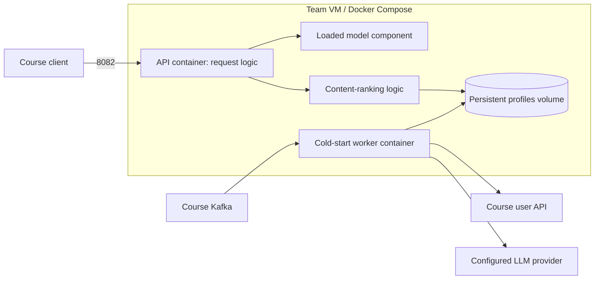

# VM deployment runbook for Milestone 1

**Status: application and container configuration are implemented, but not deployed.**
The API, SQLite-backed cold-start worker, [Dockerfile](../Dockerfile), and
[Compose file](../compose.yaml) are present. Deployment still requires a trusted
model bundle, a configured user lookup endpoint, and an OpenAI API key. No VM
deployment or live course-traffic test has been performed. Account-created Kafka
consumption is not implemented; unknown recommendation requests currently enqueue
cold-start work.

The course requires `http://VM_ADDRESS:8082/recommend/USER_ID` to return one ordered
comma-separated line of up to 20 movie IDs within 600 ms. A working container alone
does not demonstrate successful course traffic or personalized new-user behavior.

## 1. First login: identify the machine and its state

From your own computer, use the course-provided SSH username and address:

```sh
ssh YOUR_SSH_USER@YOUR_VM_ADDRESS
```

On the VM:

```sh
cat /etc/os-release
uname -m
free -h
df -h
sudo ss -ltnp | grep ':8082' || true
sudo docker version
sudo docker compose version
```

If logged in as root, omit `sudo` if it is unavailable. A missing Docker command
means installation is needed; a daemon connection failure is a different problem.
If something already occupies port 8082, identify it with the team before replacing
it. Keep working SSH access and record any VM setup in the repository runbook.

## 2. Install Docker only if needed

For a fresh supported **Ubuntu** VM, use Docker's official apt repository:

```sh
sudo apt-get update
sudo apt-get install -y ca-certificates curl git
sudo install -m 0755 -d /etc/apt/keyrings
sudo curl -fsSL https://download.docker.com/linux/ubuntu/gpg -o /etc/apt/keyrings/docker.asc
sudo chmod a+r /etc/apt/keyrings/docker.asc
```

Create the repository definition, then install Engine and the Compose plugin:

```sh
sudo tee /etc/apt/sources.list.d/docker.sources >/dev/null <<EOF
Types: deb
URIs: https://download.docker.com/linux/ubuntu
Suites: $(. /etc/os-release && echo "${UBUNTU_CODENAME:-$VERSION_CODENAME}")
Components: stable
Architectures: $(dpkg --print-architecture)
Signed-By: /etc/apt/keyrings/docker.asc
EOF
sudo apt-get update
sudo apt-get install -y docker-ce docker-ce-cli containerd.io docker-buildx-plugin docker-compose-plugin
sudo systemctl enable --now docker
sudo docker run --rm hello-world
sudo docker compose version
```

If Docker already runs, reuse it rather than reinstalling. If packages conflict,
review the machine with the team before uninstalling anything. For Debian or
another distribution, use that distribution's instructions instead of the Ubuntu
repository. Source: [Docker's Ubuntu installation guide](https://docs.docker.com/engine/install/ubuntu/).
Docker-published ports can bypass ufw rules; verify campus/VM network access rather
than assuming a host firewall rule alone controls exposure. Do not expose the
profile database, LLM service or Docker daemon to the public network.

## 3. Check out the agreed team commit

Run as the account that will maintain the checkout:

```sh
mkdir -p ~/apps
cd ~/apps
git clone https://github.com/jwatson8/The-Neural-Network.git
cd The-Neural-Network
git fetch origin
git checkout --detach YOUR_APPROVED_COMMIT_SHA
git rev-parse HEAD
```

Replace the placeholder with the commit the team agreed to deploy. If already
cloned, reuse the directory and inspect `git status --short` before switching
versions. Keep implementation edits in a development checkout and commit/push them;
the VM should deploy those commits, not become the only copy of important changes.

## 4. Application behavior and deployment inputs

The implemented service modules are:

```text
src/service/api.py             # Flask app, request routing and response
src/service/model_adapter.py   # SVD/content/popularity inference
src/service/profile_worker.py  # asynchronous profile generation
src/service/store.py           # SQLite profiles and deduplicated job queue
artifacts/model.joblib         # externally supplied trusted model bundle
```

The API loads the model once at startup, handles `/recommend/<userid>`, ranks
catalog IDs, and returns
`Response(','.join(movie_ids[:20]), mimetype='text/plain')`. The course response
must not contain JSON, titles or scores. Add `/health` returning 200 only after
the model is loaded and profile-store reads are available. Training, LLM
generation and slow metadata requests stay outside the recommendation request
path. Logs include user ID, route, model version, duration and status.

When an unknown ID is requested, the API queues it and immediately returns
popularity fallback results. The worker polls SQLite, retrieves descriptions from
the configured user API, calls OpenAI, validates the structured profile, and
persists it. Failed jobs are retried with backoff. Later requests can use the
stored profile without retraining or restarting the service. Pending fallback
responses are not personalized responses.

For a small single-VM design, SQLite with WAL, short transactions and a busy timeout
can store profiles and pending jobs in a shared Docker volume. All instances must
use the same schema and atomic updates. The API initializes the schema before
health succeeds; the worker then starts. A different shared store is acceptable
if the team documents it. Saved M0 `llm_profiles.json` entries can seed the store,
but they do not replace live profile generation.

The selected model must be serialized in the bundle shape expected by
`src/service/model_adapter.py`. Kafka account-event ingestion and its course
payload/credential contract remain future work; the current queue trigger is an
unknown recommendation request.

## 5. Containerize the implementation

Use Python 3.12 to match the measured model environment. Put runtime server and
worker dependencies in `requirements-service.txt`: Flask, Gunicorn, the chosen
Kafka client, and any LLM client needed. Pin tested versions, include transitive
dependencies in your agreed lock process, and retain the selected model's numeric
library versions to avoid artifact incompatibilities.

The root [Dockerfile](../Dockerfile) installs the pinned service and model
dependencies, runs as UID 10001, and starts Gunicorn with one worker and four
threads. The model is not copied into the image. The root `.dockerignore` excludes
local state, data, artifacts and environment files; keep credentials out of images
and shared logs. Test model/thread safety, contention and latency on the VM before
increasing concurrency. Gunicorn's worker timeout is not the course's 600 ms
response budget; measure actual HTTP latency separately.

## 6. Add compose.yaml

The root [compose.yaml](../compose.yaml) builds the same image for the API and
worker. It publishes only the API on port 8082, mounts the model read-only, and
shares a persistent named volume for profile/job state. The worker starts after
the API healthcheck succeeds. That dependency gates startup; it does not supervise
the application forever. A healthcheck reports health but does not itself restart
an unhealthy, still-running process. Source: [Compose startup behavior](https://docs.docker.com/compose/how-tos/startup-order/).

The current worker uses the external OpenAI API. Keep its key in the untracked
`.env`; do not put credentials into the image. The API profile cache is not an LLM.

## 7. Prepare a versioned model and environment

Generate or download the **selected** model using the agreed training pipeline and
library versions. For the current M0 SVD candidate, its command is:

```sh
python recommender.py train
```

That example applies only after bringing this candidate's code, environment and
data into the deployment workflow; it is not a universal command for all four
models. Save an immutable, versioned artifact rather than overwriting the currently
mounted one. For example, after training in a separate staging environment:

```sh
mkdir -p artifacts
cp /PATH/TO/TRAINED/model.joblib artifacts/model-v1.joblib
sha256sum artifacts/model-v1.joblib
cp .env.example .env
chmod 600 .env
```

Replace the path above. Do not rerun `cp .env.example .env` over a configured `.env`.
Copy the tracked [.env.example](../.env.example) to the private `.env` and set
`MODEL_FILE`, `MODEL_VERSION`, `USER_LOOKUP_URL_TEMPLATE`, and `OPENAI_API_KEY` for
the deployment. The example's user URL is a placeholder. `.gitignore` excludes
`.env`, generated model/data directories, and SQLite journal files. Ensure the
mounted model is readable by container UID 10001 and only load trusted joblib
artifacts. Record data snapshot, source commit and artifact hash.

## 8. Validate and start

From the team repository root on the VM, once the environment and model are ready:

```sh
test -s artifacts/model.joblib
sudo docker compose config --quiet
sudo docker compose up -d --build --wait --wait-timeout 120
sudo docker compose ps
sudo docker compose logs --tail=100 api cold-start-worker
```

The first command checks the example artifact path; update it if using another
version. `--wait` waits for running/healthy service state, not for evidence that
LLM generation works. Source: [docker compose up](https://docs.docker.com/reference/cli/docker/compose/up/).

## 9. Test on the VM, then from your laptop

On the VM:

```sh
curl --fail --max-time 2 http://127.0.0.1:8082/health
curl --fail --max-time 0.6 -w '\nHTTP=%{http_code} total=%{time_total}s\n' \
  http://127.0.0.1:8082/recommend/1
```

From your laptop, replacing the VM address (use `curl.exe` in Windows PowerShell):

```sh
curl --fail --max-time 0.6 -w '\nHTTP=%{http_code} total=%{time_total}s\n' \
  http://YOUR_VM_ADDRESS:8082/recommend/1
```

`-w` adds diagnostic text in your terminal only; it does not change the API body.
Use a real test user ID appropriate to the chosen model. Test several known users,
an unknown ID, and a new user whose description differs from others. Confirm
valid catalog IDs, no duplicates, no more than 20 IDs, one line, and plain text.
Repeat enough calls to inspect p50/p95/p99, not just one fast request.

If local requests succeed but laptop requests fail, inspect published ports,
listening address, campus networking and access rules. Do not disable the firewall
or change SSH rules as a blanket fix. If requests time out, inspect API logs,
startup/model loading, worker saturation and resource usage.

## 10. Prove cold start and course traffic

Observe or use an authorized test account-created event. Record the user ID and
event time, API lookup, LLM completion, persisted profile version and subsequent
content-route response. Verify a container restart retains the profile. Do not
inject events into course Kafka unless course staff permits it.

In the course stream, find requests to this team's server and corresponding status
200 entries. Record the deployment commit, chosen observation window and counts.
You need >=2,000 successful course requests and personalized successful responses
for >=10% of **all requests** in the applicable 24-hour before/after-submission
window. Local smoke tests do not satisfy that evidence. Correlate your route logs
with Kafka outcomes so fallback recommendations are not mislabeled personalized.

## 11. Routine inspection, updates and rollback

```sh
sudo docker compose ps
sudo docker compose logs --tail=100 api
sudo docker compose logs --tail=100 cold-start-worker
sudo docker stats --no-stream
df -h
```

For a new release, fetch and check out the agreed commit, prepare a new immutable
artifact if needed, update `.env`'s `DEPLOY_TAG`, `MODEL_FILE` and `MODEL_VERSION`,
then run the Step 8 startup command and repeat validation. Record the old commit,
image tag and model path before updating. Keep the prior artifact/image until the
new release is verified. A restart gap is acceptable in M1.

For rollback, check out the recorded previous commit and restore its model path
and tag in `.env`, then run the startup command. This assumes compatible profile
schema and external settings; record any required migrations. Preserve the profile
volume. **Do not use `docker compose down -v`** as a restart command: it deletes
named volumes and can discard profiles. Do not run broad Docker prune commands on
a shared VM without understanding what else uses its images/volumes.

## Architecture and report trade-off

**Question answered: how are fast requests separated from slow new-user profiling?**



The model is distinct from the surrounding API/content/business logic. The worker
does slow LLM work asynchronously. This protects request latency and avoids repeating
generation on every request, but newly arrived users initially receive a fallback
and the team must operate a worker plus durable state. The exact final diagram
must match the implemented system, including any locally hosted LLM container.

Before calling deployment complete, have a second teammate reproduce startup from
the same commit and documented environment. Link the actual Dockerfile, Compose,
worker/API implementation and runbook in the final M1 report.
